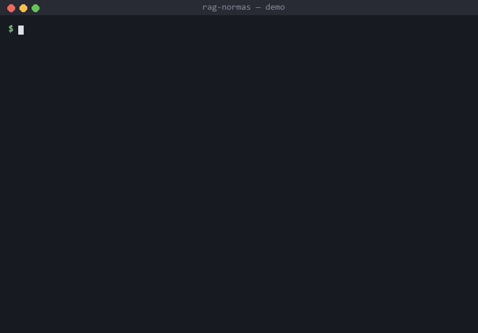
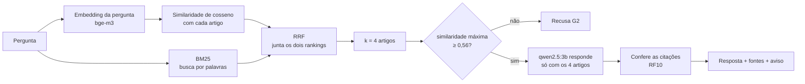

# rag-normas

Assistente de linha de comando que responde perguntas sobre a legislação federal de **arrolamento de bens e
direitos** **citando o artigo** de onde tirou cada afirmação, e que **recusa** a pergunta quando as normas
carregadas não tratam do assunto. Roda 100% local, com [Ollama](https://ollama.com): sem chave de API e sem
enviar nada para a internet.



<sub>Animação montada a partir da saída real do comando, capturada em 08/10/2026. A espera pelo modelo (1 a 2
minutos em CPU) foi encurtada.</sub>

> **Ferramenta de estudo.** Não substitui a leitura da norma nem constitui parecer.

Mini-projeto do Laboratório Introdutório (C04) da especialização em Engenharia de Software: Automação e Inovação
com IA Generativa (UFG).

## Sumário

[Para quem vai avaliar ou comentar](#para-quem-vai-avaliar-ou-comentar) · [Objetivo](#objetivo) ·
[Como funciona](#como-funciona) · [Tecnologias](#tecnologias) ·
[Instalação](#instalação) · [Uso](#uso) · [Exemplos](#exemplos) · [Testes e qualidade](#testes-e-qualidade) ·
[Resultados da avaliação](#resultados-da-avaliação) · [Como a IA foi usada](#como-a-ia-foi-usada) ·
[Limitações](#limitações) · [Próximos passos](#próximos-passos) · [Estrutura](#estrutura-do-repositório)

## Para quem vai avaliar ou comentar

Sem instalar nada, em ordem de tempo:

1. **2 min** — veja o GIF acima e a seção [Exemplos](#exemplos) (saídas reais).
2. **5 min** — leia [Resultados da avaliação](#resultados-da-avaliação) e [Limitações](#limitações): o que
   funcionou, o que não funcionou (o critério CA08, de tempo, **não foi atingido**) e por quê.
3. **10 min** — leia [`PROMPTS/`](PROMPTS/LEIAME.md), principalmente o da fase 3 sobre resposta e recusa: mostra como
   a IA foi conduzida e onde errou.

Para rodar os testes, **não precisa do Ollama**: `pip install -r requirements-dev.txt` e `python -m pytest -q`
(249 testes, cerca de 3 s). Para rodar o assistente, precisa do Ollama e de cerca de 3 GB livres (ver
[Instalação](#instalação)); cada resposta leva de 1 a 2 minutos em computador sem placa de vídeo.

Onde o retorno ajuda mais: a **métrica de avaliação** (mede presença de itens, não correção), o **prompt do modelo
pequeno** e a **busca** (BM25 + vetor + RRF). Termos técnicos estão no [glossário](docs/glossario.md).

## Objetivo

Quem estuda o arrolamento de bens (procedimento da Receita Federal que acompanha o patrimônio de quem tem dívida
tributária alta) precisa consultar três normas que se completam e, às vezes, se sobrepõem. Um chatbot genérico
responde com segurança, mas não diz de onde tirou a resposta e pode inventar artigo.

O `rag-normas` usa **RAG** (*Retrieval-Augmented Generation*, geração apoiada em busca): primeiro busca os artigos
relevantes no texto das normas, depois pede a um modelo de linguagem local que responda **só com base neles**, e
por fim confere as citações. Três regras de segurança (*guardrails*) valem em toda resposta:

| | Regra |
|---|---|
| **G1** | Toda afirmação traz `[Fonte: <norma>, art. N]`; a resposta lista as fontes consultadas. |
| **G2** | Se nenhum artigo for parecido o bastante com a pergunta, o sistema **recusa** ("Não encontrei isso nas normas carregadas.") em vez de gerar texto. A decisão é do código, não do modelo. |
| **G3** | Toda saída termina com o aviso de que é ferramenta de estudo. |

E uma checagem (RF10): se a resposta citar um artigo que **não existe** no índice, a saída avisa.

**Corpus** (31 artigos, um fragmento por artigo; procedência e data da cópia em
[`data/normas/FONTES.md`](data/normas/FONTES.md)):

| Norma | Artigos |
|---|---:|
| IN RFB nº 2.091/2022 (texto vigente, com as alterações até a IN RFB nº 2.338/2026) | 27 |
| Lei nº 9.532/1997, arts. 64 e 64-A | 2 |
| Decreto nº 7.573/2011 (atualiza o limite de valor do art. 64) | 2 |

## Como funciona



- **Indexação** (`index`, uma vez): divide as normas em artigos e calcula o vetor (*embedding*) de cada um.
- **Busca híbrida**: vetor (entende sinônimos) + BM25 (acha o termo exato, como "64-A"), fundidos por *Reciprocal
  Rank Fusion*.
- **Limiar de recusa e constante do RRF** foram calibrados com o conjunto de avaliação (ver
  [Resultados](#resultados-da-avaliação)).

Detalhes e decisões de projeto: [`docs/arquitetura.md`](docs/arquitetura.md). Termos técnicos explicados:
[`docs/glossario.md`](docs/glossario.md).

## Tecnologias

| | |
|---|---|
| Linguagem | Python 3.14 (só biblioteca padrão, mais o cliente `ollama`) |
| Modelos locais | [Ollama](https://ollama.com): `qwen2.5:3b` (respostas) e `bge-m3` (embeddings) |
| Busca | BM25 e RRF escritos no projeto; índice em um arquivo JSON (sem banco vetorial) |
| Testes | `pytest`, com modelo simulado (rodam sem Ollama) |
| Qualidade | `ruff` (linter e formatador), teste de mutação manual |
| Desenvolvimento | Claude Code (ver [Como a IA foi usada](#como-a-ia-foi-usada)) |

Sem LangChain nem framework de orquestração, de propósito: o objetivo era entender e testar cada etapa.

## Instalação

**Pré-requisitos:** Python 3.14 e o [Ollama](https://ollama.com/download) instalado e aberto. Cerca de 3 GB de
memória livre para o modelo de 3 bilhões de parâmetros.

```bash
# 1. Baixar os modelos (uma vez, cerca de 3 GB)
ollama pull qwen2.5:3b
ollama pull bge-m3

# 2. Clonar e criar o ambiente virtual
git clone https://github.com/rodrigovelosok/rag-normas.git
cd rag-normas
python -m venv .venv
```

Ativar o ambiente virtual:

```bash
.venv\Scripts\activate        # Windows
source .venv/bin/activate     # Linux / macOS
```

Instalar as dependências:

```bash
pip install -r requirements.txt        # para usar
pip install -r requirements-dev.txt    # para rodar testes e linter (inclui o anterior)
```

## Uso

```bash
python -m rag_normas index                     # cria o índice (uma vez; cerca de 1 minuto)
python -m rag_normas ask "Sua pergunta aqui"   # responde
python -m rag_normas ask "Sua pergunta" --scores   # mostra também a similaridade de cada artigo
```

O índice é gravado em `data/index.json` (fora do git, pode ser recriado). Se trocar o modelo de embedding, rode
`index` de novo: o programa avisa se o índice for de outro modelo.

**Configuração** — por opção da linha de comando ou variável de ambiente (a opção tem prioridade):

| Opção | Variável | Padrão | Para quê |
|---|---|---|---|
| `--model` | `RAG_CHAT_MODEL` | `qwen2.5:3b` | modelo que escreve a resposta |
| `--embed-model` | `RAG_EMBED_MODEL` | `bge-m3` | modelo dos vetores |
| `-k`, `--top-k` | `RAG_TOP_K` | `4` | quantos artigos o modelo recebe |
| `--rrf-k` | `RAG_RRF_K` | `5` | constante do RRF |
| `--min-similarity` | `RAG_MIN_SIMILARITY` | `0.56` | limiar de recusa |
| `--host` | `RAG_OLLAMA_HOST` | `http://localhost:11434` | endereço do Ollama |
| `--index` | `RAG_INDEX_PATH` | `data/index.json` | arquivo do índice |
| `--corpus` | `RAG_CORPUS_DIR` | `data/normas` | pasta com os textos |
| — | `RAG_NUM_CTX` | `8192` | tamanho do contexto do modelo (tokens) |
| — | `RAG_TIMEOUT` | `300` | segundos de espera pelo Ollama |

Códigos de saída: `0` sucesso, `1` erro (Ollama fora do ar, índice ausente…), `2` uso incorreto. Os erros saem em
uma linha, começando por `Erro:`, com a instrução de como resolver.

## Exemplos

Saídas reais (`qwen2.5:3b`, CPU, 08/10/2026).

**Pergunta respondida** (100 s nesta execução):

```text
$ python -m rag_normas ask "Qual o prazo para comunicar a venda de um bem arrolado?"
[Fonte: IN RFB 2.091/2022, art. 12, § 3º] O sujeito passivo fica obrigado a comunicar à Secretaria Especial da
Receita Federal do Brasil a alienação, a oneração ou a transferência a qualquer título, inclusive aquela decorrente
de cisão parcial, desapropriação, sentença ou escritura de partilha, integralização de capital, perda total,
arrematação ou adjudicação por terceiro em leilão ou pregão, ou consolidação de propriedade fiduciária a terceiro,
de qualquer dos bens ou direitos arrolados, no prazo de cinco dias, contado da data da ocorrência do fato.

Fontes consultadas:
- Lei 9.532/1997, art. 64
- IN RFB 2.091/2022, art. 12
- IN RFB 2.091/2022, art. 15
- IN RFB 2.091/2022, art. 21

Ferramenta de estudo. Não substitui a leitura da norma nem constitui parecer.
```

**Pergunta fora das normas** (1 s: a recusa acontece antes de chamar o modelo de chat):

```text
$ python -m rag_normas ask "Qual a alíquota do IRPF?"
Não encontrei isso nas normas carregadas.

Ferramenta de estudo. Não substitui a leitura da norma nem constitui parecer.
```

Note que o modelo pequeno tende a **copiar** o trecho da norma em vez de resumi-lo; em perguntas de lista, às
vezes omite itens (ver [Limitações](#limitações)).

## Testes e qualidade

```bash
python -m pytest -q             # 249 testes, cerca de 3 s, não precisa do Ollama
python -m ruff check .          # linter
python -m ruff format --check . # formatação
```

Os testes usam funções falsas no lugar do Ollama (*injeção de dependência*), então rodam em qualquer máquina. A
qualidade dos próprios testes foi conferida com **teste de mutação**: o código foi alterado de propósito, cerca de
200 vezes ao longo do projeto, para ver se algum teste falhava; cada alteração que passava sem ser notada virou
teste novo.

**Avaliação do sistema** (precisa do Ollama; ver [`eval/`](eval/)):

```bash
python -m eval.avaliar retrieval              # só a busca: recuperação por k e varredura do limiar (~20 s)
python -m eval.avaliar answers --model qwen2.5:3b   # 21 perguntas de ponta a ponta (~40 min em CPU)
python -m eval.avaliar rescore --input <arquivo.jsonl> --model <modelo>   # reavalia respostas gravadas
python -m eval.avaliar compare --inputs a.jsonl b.jsonl --names A B        # compara rodadas
```

## Resultados da avaliação

Conjunto de **21 perguntas** com gabarito ([`eval/perguntas.json`](eval/perguntas.json)): 16 respondíveis (fatos
pontuais, listas, combinação de normas e perguntas difíceis) e 5 fora do corpus (devem ser recusadas). Cada
pergunta tem os artigos esperados e os itens que a resposta precisa conter. Relatórios completos em
[`eval/relatorios/`](eval/relatorios/).

**Calibração.** O valor da literatura para a constante do RRF (60) recuperava os artigos esperados em 84% dos casos
com k = 4; com 5, em **97%**. O limiar de recusa 0,56 fica no meio da faixa (0,54 a 0,58) em que nenhuma pergunta é
recusada indevidamente e nenhuma pergunta fora do corpus é respondida.

**3b × 7b** (mesmas perguntas e configuração):

| | `qwen2.5:3b` (padrão) | `qwen2.5:7b` |
|---|---:|---:|
| Respostas corretas (completas, citando os artigos esperados) | 12 de 21 | 12 de 21 |
| Itens do gabarito presentes | 73% | 77% |
| Citação dos artigos esperados | 86% | 90% |
| Perguntas fora do corpus recusadas | 5 de 5 | 5 de 5 |
| Citações de artigos inexistentes | 0 | 0 |
| Tempo médio por pergunta respondida (CPU) | 60,5 s | 161,6 s |

O 7b acerta perguntas diferentes, mas não mais, e é 2,7 vezes mais lento: o 3b continua como padrão.

**Critérios de aceitação** ([`docs/requisitos.md`](docs/requisitos.md)):

| | Critério | Meta | Resultado |
|---|---|---|---|
| CA01–CA02 | Divisão correta em artigos, com parágrafos e incisos | 100% | ✅ testes unitários |
| CA03 | Artigo esperado entre os k = 4 recuperados | ≥ 80% | ✅ 97% |
| CA04 | Perguntas fora do corpus recusadas | ≥ 90% | ✅ 100% (5 de 5) |
| CA05 | Nenhuma citação de artigo inexistente | 100% | ✅ 0 em 4 rodadas completas de 21 perguntas |
| CA06 | Aviso G3 em toda saída | 100% | ✅ testes unitários |
| CA07 | Testes passam sem Ollama | 100% | ✅ 249 testes, ~3 s |
| CA08 | Tempo médio com `qwen2.5:3b` | ≤ 60 s | ❌ **60,5 s** (variação de 7 a 106 s, em CPU) |
| CA09 | Comparação 3b × 7b reportada | relatório | ✅ [`comparacao.md`](eval/relatorios/comparacao.md) |

## Como a IA foi usada

O projeto foi desenvolvido com o **Claude Code** (agente de programação da Anthropic), com os modelos Claude Opus 5.5
e Claude Sonnet 5.5 conforme a fase. A divisão de trabalho foi:

- **A IA** escreveu os prompts de cada fase (formato CO-STAR, versionados em [`PROMPTS/`](PROMPTS/LEIAME.md)), o código, os
  testes e a documentação, e executou testes, medições e experimentos.
- **O autor** escolheu o tema e o escopo, tomou as decisões de projeto, revisou cada fase, trouxe o conhecimento
  do domínio e autorizou cada publicação no GitHub. Os commits com participação da IA trazem a linha
  `Co-Authored-By`.

Cada arquivo de `PROMPTS/` traz o prompt, o resultado obtido e uma lista de revisão humana.

### Desafios superados

- **O modelo simulado não mostra o comportamento do modelo real.** Os testes unitários da geração passaram de
  primeira, mas o primeiro teste com o Ollama mostrou o `qwen2.5:3b` **recusando perguntas que a norma responde**:
  a regra de recusa escrita no prompt o deixava cauteloso demais. A IA montou um experimento controlado (mesma
  pergunta, mesmos artigos, cinco variantes de prompt) e a solução foi tirar a recusa do modelo: quem recusa é o
  código, pelo limiar de similaridade. Um lembrete do formato de citação no **fim** da mensagem fez o modelo passar
  a citar no formato pedido.
- **Valor "da literatura" não é valor certo.** A varredura da constante do RRF mostrou que o padrão 60 era ruim para
  este corpus; trocar para 5 levou a recuperação de 84% para 97%.
- **Medir o instrumento de medida.** A leitura manual das respostas achou 4 itens que o gabarito marcava como
  ausentes, mas que o modelo tinha acertado com outras palavras. O gabarito foi corrigido e foi criado o comando
  `rescore`, que reavalia respostas gravadas sem rodar o modelo de novo.
- **"Passou de primeira" não prova que os testes são bons.** O teste de mutação achou testes fracos em vários
  módulos (uma âncora de expressão regular, um desempate do RRF, seções de relatório só protegidas por comparação
  de saída) e todos foram reforçados.

### Ganhos de produtividade

Medição direta (o mesmo projeto feito sem IA) não existe, então os números abaixo são indicadores, não prova:

- As fases 1 a 5 do plano (requisitos, arquitetura, núcleo, avaliação e refatoração), previstas para 07 a 16/10,
  ficaram prontas em 07 e 08/10.
- 249 testes, 21 perguntas de avaliação com gabarito, 4 rodadas completas de avaliação e 30 commits nesse período.
- O maior ganho não foi escrever código, e sim **experimentar**: varreduras de calibração, comparação de modelos,
  teste de mutação e reavaliação de respostas, que sem um agente seriam caros demais para um mini-projeto.

Em contrapartida, revisar o que a IA produz leva tempo e exige entender o que foi feito.

### Decisões de projeto influenciadas pela IA

- Isolar o Ollama em um único módulo (`rag_normas/llm.py`), para que todo o resto pudesse ser testado sem ele.
- Recusa decidida por código (limiar), e não pelo modelo, depois do experimento descrito acima.
- Avaliar a busca separada do modelo de chat: a calibração passou a levar segundos, não horas.
- O avaliador, que cresceu num único arquivo, foi dividido por responsabilidade na fase de refatoração, com o
  comportamento conferido por testes e por comparação byte a byte das saídas (*golden master*).

### Revisão humana: onde fez diferença

- **Fonte das normas.** A IA propôs usar uma cópia de terceiros da IN. O autor trouxe o texto oficial vigente, com
  uma alteração de 2026 que nenhuma busca da IA tinha mostrado. Fato jurídico se confere na fonte primária.
- **Corpus.** A IA recomendou deixar o Decreto 7.573/2011 de fora. O autor decidiu incluí-lo, porque ele atualiza o
  limite de valor da lei, e há uma pergunta de avaliação só sobre isso.
- **Conjunto de avaliação.** A IA propôs as perguntas e o autor as tornou mais exigentes: respostas de lista devem
  trazer **todos** os incisos (o que levou ao gabarito por itens), e entraram perguntas difíceis sobre bens de
  cônjuge, responsabilidade solidária e subsidiária e substituição de bens entre devedores.

### Lições aprendidas e erros da própria IA

- **Erro da IA:** durante um teste de mutação, código alterado de propósito gravou um índice falso por cima do
  índice real (arquivo regenerável, fora do git). Desde então, os experimentos protegem os arquivos reais.
- **Erro da IA:** a IA estimou de 10 a 15 minutos por pergunta para o modelo 7b; o medido foi de 2 a 3,5 minutos.
  Medir antes de planejar passou a ser regra.
- **Experimento com resultado negativo:** trocar "responda em poucas frases" por "traga todos os itens" no prompt
  **não** deixou as respostas mais completas (10 de 21 contra 12, diferença dentro do ruído). O prompt original foi
  mantido e o resultado ficou registrado.
- **Métrica tem ponto cego:** "12 de 21 corretas" significa "completa e citada", não "juridicamente correta" (ver
  Limitações). Revisão humana continua necessária.

## Limitações

- **A métrica mede presença, não correção.** Uma resposta pode trazer todos os itens do gabarito e afirmar algo
  errado ao lado: numa pergunta difícil, o 3b disse que o devedor principal *precisa* atingir os limites de valor,
  o contrário do art. 15, § 5º, e a métrica não percebeu.
- **O modelo pequeno omite itens.** 9 das 16 perguntas respondíveis tiveram resposta incompleta ou sem algum artigo
  esperado; as perguntas que combinam normas e as difíceis são as mais afetadas.
- **Tempo em CPU.** Média de 60,5 s por resposta com o 3b, com grande variação (7 a 106 s); sem GPU, a leitura do
  prompt (cerca de 3.000 tokens) é o gargalo. O critério CA08 (≤ 60 s) não foi atingido.
- **Calibração otimista.** O limiar e a constante do RRF foram escolhidos com as mesmas 21 perguntas usadas para
  medir; em perguntas novas, o desempenho pode ser menor. A folga do limiar é pequena (0,05).
- **Corpus pequeno e datado.** 31 artigos copiados em 07/10/2026; alterações posteriores das normas não estão
  incluídas. O Anexo Único da IN (formulário) não faz parte do texto.
- **Busca:** com k = 4, o artigo do Decreto ainda não é recuperado na pergunta que exige combinar o Decreto com a
  Lei.
- Sem memória de conversa: cada pergunta é independente.

## Próximos passos

- Acrescentar ao gabarito "afirmações proibidas" por pergunta, para a métrica pegar respostas com erro de conteúdo.
- Ampliar o conjunto de avaliação e separar perguntas de calibração das perguntas de teste.
- Repetir as rodadas para medir a variação entre execuções antes de comparar prompts.
- Testar modelos maiores com GPU, onde o custo de tempo do 7b deixaria de pesar.
- Incluir outras normas sobre garantia do crédito tributário (por exemplo, a medida cautelar fiscal).

## Estrutura do repositório

```text
rag_normas/      o programa: ingest (normas → artigos), index, search (BM25 + vetor + RRF),
                 llm (único módulo que fala com o Ollama), generate (prompt, recusa, citações), config, cli
eval/            avaliação: perguntas.json (gabarito), avaliar.py e módulos, relatorios/ (resultados)
tests/           testes unitários (pytest), um arquivo por módulo
data/normas/     textos das normas e FONTES.md (procedência)
docs/            requisitos, arquitetura (decisões), glossário, imagem da demonstração
PROMPTS/         prompts usados em cada fase do desenvolvimento, com resultado e revisão
```

## Documentação

- Requisitos e critérios de aceitação: [`docs/requisitos.md`](docs/requisitos.md)
- Arquitetura e decisões: [`docs/arquitetura.md`](docs/arquitetura.md)
- Glossário de termos técnicos: [`docs/glossario.md`](docs/glossario.md)
- Procedência dos textos: [`data/normas/FONTES.md`](data/normas/FONTES.md)

## Autor e licença

Rodrigo Kobayashi. Código sob licença [MIT](LICENSE). Os textos normativos em `data/normas/` são de domínio público
(Lei nº 9.610/1998, art. 8º, IV).
